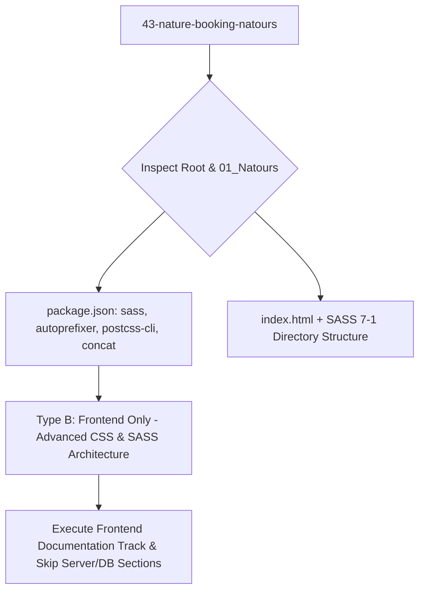

# Project Type Pre-Check: 43-Nature-Booking-Natours (Wanderly)

## Step 0 Pre-Check Analysis

- **Detected Track**: **Track B: Frontend Only (CSS Architecture & Advanced SASS)**
- **Project Root**: `/Users/avishjain/avishjain9-repos/43-nature-booking-natours`
- **Application Directory**: `01_Natours/`
- **Primary Domain**: High-performance responsive tour booking showcase leveraging 7-1 SASS architecture, BEM methodology, pure CSS component state engines, and modern browser rendering optimizations.

### Evidence Matrix

| Evidence Factor | Codebase Artifact | Concrete Findings | Verdict |
|---|---|---|---|
| **Package Dependencies** | `01_Natours/package.json` | `sass@^1.53.0`, `autoprefixer@^10.4.7`, `concat@^1.0.3`, `postcss-cli@^10.0.0`, `npm-run-all@^4.1.5` | Pure frontend compilation toolchain; no backend frameworks (Express/Nest/FastAPI). |
| **Backend Code** | Entire Repository | No `server.js`, `app.js`, Node HTTP listeners, Express routes, or Python/Go backend scripts. | **Not applicable** (Skip backend & server scaling). |
| **Database Layer** | Entire Repository | No MongoDB/Mongoose schemas, SQL migrations, Prisma ORM, or database connections. | **Not applicable** (Client-side presentation & CSS state machines). |
| **Styling & Markup Architecture** | `01_Natours/sass/` | 7-1 SASS Pattern: `abstracts/`, `base/`, `components/`, `layout/`, `pages/`, `main.scss` | Advanced production CSS architecture with BEM naming conventions. |
| **Interactive Mechanisms** | `01_Natours/sass/components/` | Pure CSS state machine via checkbox hack (`_navigation.scss`), `:target` modal (`_popup.scss`), 3D perspective flip (`_card.scss`). | Zero JavaScript dependencies for core UI states; 100% GPU-accelerated CSS rendering. |

### Document Adaptation Strategy

1. **Frontend Focus**: Deep-dive into SASS compilation pipelines, BEM specificity management, CSS layout engines (Floats vs Flexbox vs Grid), 3D perspective transformations, GPU compositing layers, and responsive breakpoint mixins.
2. **Database & Server Sections**: Marked explicitly as `Not applicable for this project type (Frontend-only static presentation architecture)`.
3. **AI Pipeline**: Documented as `No AI integration present in repository`. Provided architectural blueprint for potential client-side AI integration (TensorFlow.js tour recommendation / CLIP vision search).
4. **Master Checklist**: All 275 items evaluated with strict adherence to real code citations or explicit "Not applicable" justifications.
