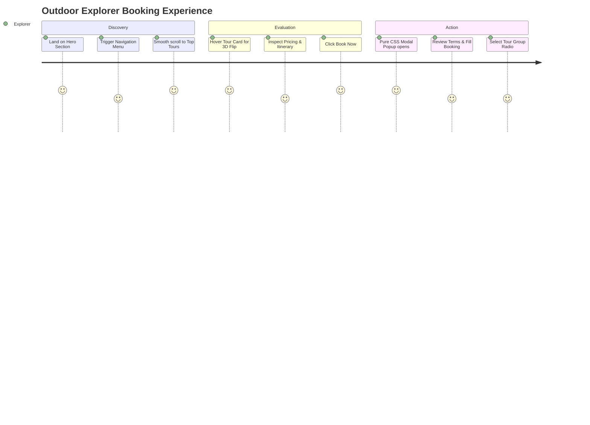
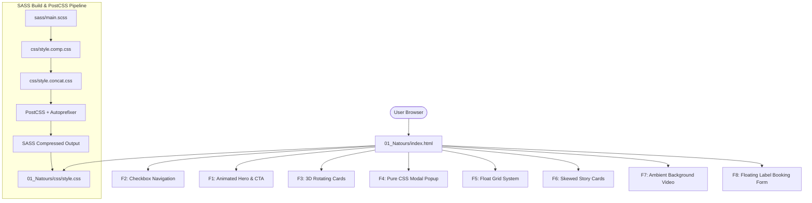
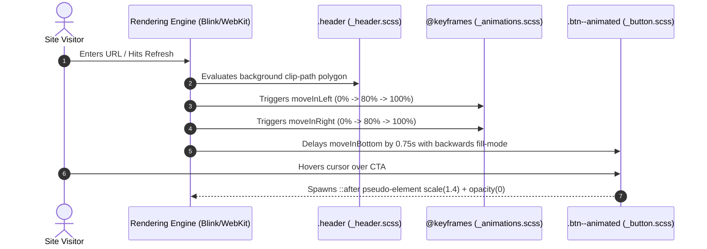
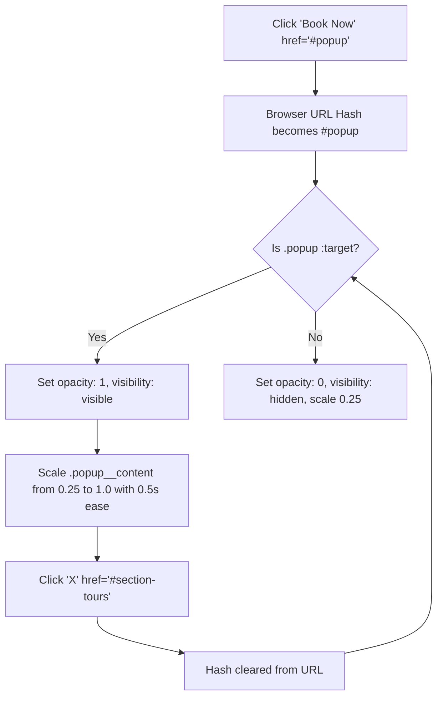
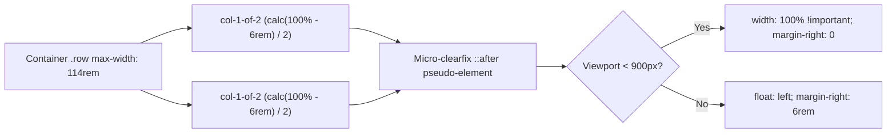

# Full Project Analysis: Natours (Wanderly)

## 0.1 What the Project Is

**Wanderly (Natours)** is an outdoor tour booking and expedition platform designed to showcase curated nature adventures (Forest Hiker, Ocean Explorer, Snow Adventurer). The application solves the problem of high-friction, slow-loading travel booking pages by implementing a zero-runtime-overhead, 100% pure CSS-driven user experience.

### Main User Journey



---

## 0.2 Master Feature Inventory & Traces

### System Overview Diagram



### F1: Hero Header & Animated Call-to-Action (CTA)
- **User Action**: Explorer loads landing page; hero text slides in smoothly from left and right; animated pill button appears from bottom and pulses on hover.
- **Trace**: `01_Natours/index.html` lines 14-29 (`.header`, `.heading-primary`, `.btn--animated`) -> `sass/layout/_header.scss` -> `sass/base/_animations.scss` (`@keyframes moveInLeft`, `@keyframes moveInRight`, `@keyframes moveInBottom`) -> `sass/components/_button.scss`.
- **CSS Engine**: Hardware-accelerated GPU transitions via `transform: translateX()` and `opacity`. Pseudo-element ripple via `::after` with `transition: all .4s`.



### F2: Pure CSS Fullscreen Navigation (Checkbox Hack)
- **User Action**: User clicks circular hamburger icon; background disc expands radial green gradient across viewport; nav links emerge smoothly.
- **Trace**: `01_Natours/sass/layout/_navigation.scss` lines 1-215. Leverages `<input type="checkbox" id="navi-toggle" class="navigation__checkbox">`.
- **CSS Engine**: Sibling selector `.navigation__checkbox:checked ~ .navigation__background` scales `transform: scale(80)`.
- **Failure State**: If HTML structure changes and `<label>` is separated from `<input>`, the hack fails. Fallback: Standard button with ARIA attributes.

```mermaid
stateDiagram-v2
    [*] --> Closed: Initial Page Load
    Closed --> Expanding: User Clicks Hamburger Label
    note right of Expanding: Checkbox:checked activates ~ .navigation__background transform scale(80)
    Expanding --> Open: Radial gradient covers 100vw/100vh
    Open --> Collapsing: User Clicks Nav Link or Label
    Collapsing --> Closed: Scale returns to 0, opacity 0, width 0
```

### F3: Interactive 3D Perspective Rotating Tour Cards
- **User Action**: User hovers over tour package card; card smoothly rotates 180 degrees in 3D space, revealing back side with price, duration, and booking CTA.
- **Trace**: `01_Natours/sass/components/_card.scss` lines 1-236.
- **CSS Engine**: Parent `.card` defines `perspective: 150rem`. Child `.card__side--front` rotates to `-180deg`, while `.card__side--back` rotates from `180deg` to `0deg`. Uses `backface-visibility: hidden`.
- **Failure Path**: On touch devices, `:hover` does not naturally persist. Handled via `@media only screen and (hover: none)` which collapses the card into a single continuous vertical block.

```mermaid
sequenceDiagram
    autonumber
    actor User as Explorer
    participant Front as .card__side--front
    participant Back as .card__side--back
    participant Compositor as GPU Compositor Layer

    User->>Front: Mouse enters .card container
    Front->>Compositor: transform: rotateY(-180deg) (cubic-bezier)
    Back->>Compositor: transform: rotateY(0deg) (cubic-bezier)
    Compositor-->>User: Backface hidden prevents mirroring; price details rendered
    User->>Front: Mouse leaves .card container
    Front->>Compositor: transform: rotateY(0deg)
    Back->>Compositor: transform: rotateY(180deg)
```

### F4: Pure CSS Modal Booking Popup (`:target` pseudo-class)
- **User Action**: Clicking "Book now!" with href `#popup` opens a full-screen blurred backdrop modal window with two-column content and terms.
- **Trace**: `01_Natours/sass/components/_popup.scss` lines 1-147.
- **CSS Engine**: URL hash updates to `#popup`. Selector `.popup:target` triggers `opacity: 1; visibility: visible;`. Modal content scales from `scale(.25)` to `scale(1)`. Close button points to anchor `#section-tours` or `#`, resetting target.



### F5: Custom Responsive Float Grid System
- **User Action**: Page smoothly renders 2, 3, and 4-column balanced layouts across mobile, tablet, and desktop screens.
- **Trace**: `01_Natours/sass/layout/_grid.scss` lines 1-110. Uses mathematical SASS variables `$grid-width`, `$gutter-horizontal`, `$gutter-vertical`.
- **CSS Engine**: Dynamic calculation via `calc((100% - #{$gutter-horizontal}) / 2)` and clearfix mixin `@include clearfix`. In tablet portrait (`$breakpoint == tab-port`), columns collapse to `width: 100% !important`.



### F6: Skewed Story Cards with Circular Shape-Outside Avatar
- **User Action**: User scrolls to customer review stories; testimonial card is skewed by `-12deg`, but the inner text and circular image un-skew by `12deg` for perfect legibility, with text wrapping around a circular photo.
- **Trace**: `01_Natours/sass/components/_story.scss` lines 1-104.
- **CSS Engine**: `transform: skewX(-12deg)` on `.story`, `transform: skewX(12deg)` on `.story__shape`. Shape wrapping via `shape-outside: circle(50% at 50% 50%)` and `clip-path: circle(50% at 50% 50%)`.

### F7: Ambient Background Video
- **User Action**: Behind the customer stories, a muted scenic nature video loops continuously with low opacity to preserve text contrast.
- **Trace**: `01_Natours/sass/components/_bg-video.scss` lines 1-17.
- **CSS Engine**: Absolute positioning covering 100% width and height, `object-fit: cover`, `opacity: .15`, `z-index: -1`, with `overflow: hidden`.

### F8: Booking Form with Floating Label Transitions & Custom Radio Buttons
- **User Action**: User fills out reservation form; input placeholder smoothly disappears while a small label slides up; custom radio buttons display animated green inner dot.
- **Trace**: `01_Natours/sass/components/_form.scss` lines 1-124.
- **CSS Engine**: Sibling selector `:placeholder-shown + .form__label` applies `opacity: 0; visibility: hidden; transform: translateY(-4rem);`. When text is typed, placeholder is no longer shown, triggering smooth transition into view.

---

## 0.3 Final Inventory Counts

| Architectural Metric | Count | Code Verification Reference |
|---|---|---|
| **Total HTML Pages** | 1 | `01_Natours/index.html` |
| **SASS Source Files** | 21 | `01_Natours/sass/**/*.scss` |
| **SASS Architecture Pattern** | 7-1 | `abstracts/`, `base/`, `components/`, `layout/`, `pages/`, `main.scss` |
| **CSS Keyframe Animations** | 3 | `moveInLeft`, `moveInRight`, `moveInBottom` in `_animations.scss` |
| **Pure CSS State Machines** | 3 | Checkbox Hack (Nav), `:target` (Popup), `:hover` 3D (Cards) |
| **Responsive Breakpoints** | 4 | `phone` (600px), `tab-port` (900px), `tab-land` (1200px), `big-desktop` (1800px) |
| **Build & Toolchain Scripts** | 6 | `watch-sass`, `compile-sass`, `concat-css`, `prefix-css`, `compress-css`, `build-css` |
| **Dependencies / DevDependencies** | 5 | `sass`, `autoprefixer`, `concat`, `postcss-cli`, `npm-run-all` |
