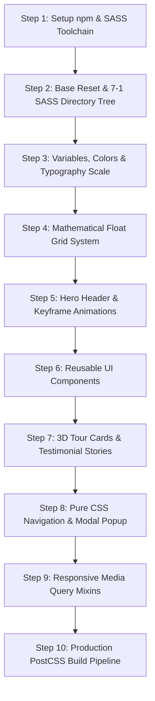

# Step-by-Step Rebuild Guide: Natours

To construct Wanderly from scratch in exact dependency order:



### Step 1: Package Initialization & Build Scripts
Initialize `package.json` with Dart Sass, Autoprefixer, PostCSS CLI, and npm-run-all.

```json
{
  "name": "wanderly",
  "version": "1.0.0",
  "scripts": {
    "watch-sass": "sass --watch sass/main.scss:css/style.css",
    "compile-sass": "sass sass/main.scss css/style.comp.css",
    "concat-css": "concat -o css/style.concat.css css/icon-font.css css/style.comp.css",
    "prefix-css": "postcss --use autoprefixer -b 'last 10 versions' css/style.concat.css -o css/style.prefix.css",
    "compress-css": "sass css/style.prefix.css css/style.css --style compressed",
    "build-css": "npm-run-all compile-sass concat-css prefix-css compress-css"
  }
}
```

### Step 2: Establish Base Normalization & Box Sizing
In `sass/base/_base.scss`, set the foundational root rem unit based on a percentage of browser default (16px * 62.5% = 10px = 1rem) for simplified responsive scaling.

```scss
*,
*::after,
*::before {
    margin: 0;
    padding: 0;
    box-sizing: inherit;
}

html {
    // Defines what 1rem is: 10px/16px = 62.5%
    font-size: 62.5%;

    @include respond(tab-land) {
        font-size: 56.25%; // 1rem = 9px
    }
    @include respond(tab-port) {
        font-size: 50%; // 1rem = 8px
    }
    @include respond(big-desktop) {
        font-size: 75%; // 1rem = 12px
    }
}

body {
    box-sizing: border-box;
    padding: 3rem;
}
```
