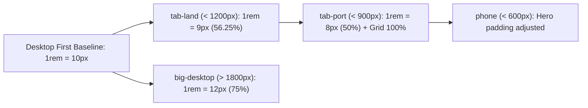

# Architecture & System Design: Natours (Wanderly)

## High-Level Architecture Overview

Wanderly follows a decoupled frontend presentation architecture centered around an optimized build pipeline that compiles modular SASS source files into a unified, vendor-prefixed, and minified stylesheet.

```mermaid
flowchart TD
    subgraph Development[SASS 7-1 Source Directory]
        Abstracts[sass/abstracts/_variables, _mixins]
        Base[sass/base/_base, _typography, _animations]
        Layout[sass/layout/_header, _grid, _navigation, _footer]
        Components[sass/components/_card, _popup, _button, _form]
        Pages[sass/pages/_home]
    end

    Development --> Entry[sass/main.scss]
    Entry --> DartSass[Dart Sass Compiler]
    DartSass --> RawCSS[css/style.comp.css]
    RawCSS --> Concat[concat utility: merges icon fonts]
    Concat --> PostCSS[PostCSS Engine + Autoprefixer]
    PostCSS --> PrefixedCSS[css/style.prefix.css]
    PrefixedCSS --> Minifier[Dart Sass --style compressed]
    Minifier --> DistCSS[css/style.css (<30KB)]
    DistCSS --> Browser[Browser Blink/WebKit Rendering Engine]
```

---

## Browser Rendering Pipeline & GPU Compositing

To guarantee 60 FPS across all animations, Wanderly strictly restricts dynamic visual changes to properties that bypass Layout (Reflow) and Paint, triggering only **Composite**:

| CSS Property | Triggers Layout (Reflow)? | Triggers Paint? | Triggers Composite? | Performance Impact |
|---|---|---|---|---|
| `top` / `left` / `margin` | **Yes (Expensive)** | **Yes** | Yes | Causes CPU-bound frame drops and jank. |
| `width` / `height` | **Yes (Expensive)** | **Yes** | Yes | Recomputes entire page geometry. |
| `transform: translate()` | **No** | **No** | **Yes (GPU)** | **Silky smooth 60 FPS; executed on compositor thread.** |
| `transform: rotateY()` | **No** | **No** | **Yes (GPU)** | **Direct 3D hardware-accelerated matrix multiplication.** |
| `opacity` | **No** | **No** | **Yes (GPU)** | **Handled natively by GPU texture blending.** |

---

## Responsive Breakpoint Strategy

Responsive adjustments are centralized inside a single mixin in `sass/abstracts/_mixins.scss`:


