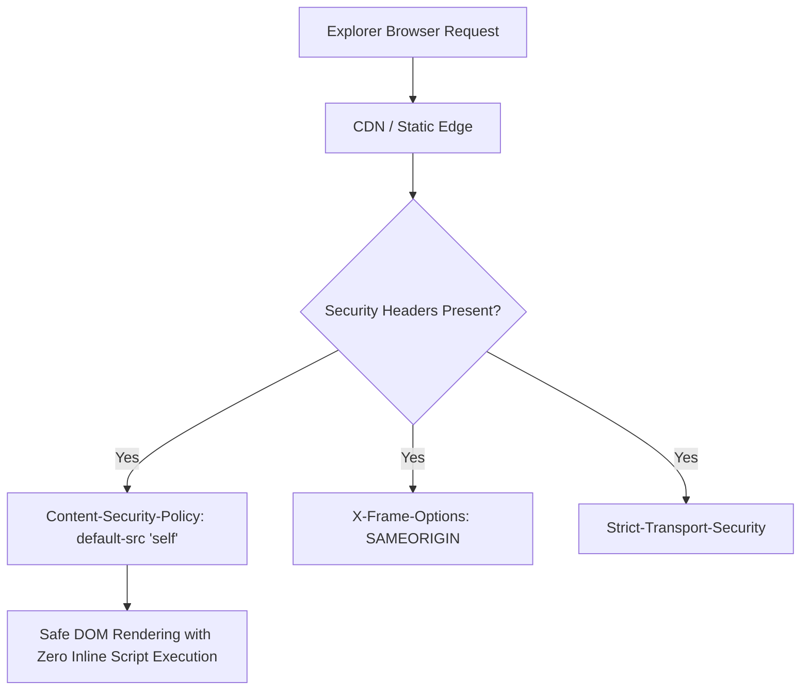

# Security Audit & Hardening Matrix: Natours

## OWASP Top 10 Evaluation for Static Frontend

| Threat Category | Severity in Static Context | Implemented Protection | Recommended Hardening |
|---|---|---|---|
| **A01: Broken Access Control** | Low (No Server Auth) | All content is public tour information. | If booking forms submit data, protect endpoints with JWT/CSRF tokens. |
| **A02: Cryptographic Failures** | Medium | Assets served over HTTPS on modern hosts. | Enforce HSTS (`Strict-Transport-Security: max-age=31536000`). |
| **A03: Injection (XSS)** | High | Static HTML contains zero `innerHTML` or dynamic template injections. | Implement strict Content Security Policy (CSP) blocking unauthorized scripts. |
| **A05: Security Misconfiguration** | Medium | No directory listings; zero exposed credentials or `.env` files. | Configure HTTP security headers (`X-Frame-Options: DENY`, `X-Content-Type-Options: nosniff`). |
| **Reverse Tabnabbing** | Medium | External links include standard anchors. | Ensure all `target="_blank"` links include `rel="noopener noreferrer"`. |

