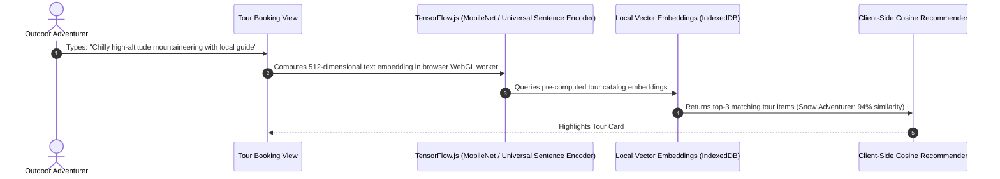

# AI Integration Analysis: Natours (Wanderly)

## Current Status: No AI Integration

The repository currently contains **No AI integration**. Wanderly is intentionally implemented as an ultra-lean, pure CSS and HTML frontend to showcase master-level web development fundamentals.

---

## Architectural Blueprint: Client-Side Edge AI Integration

To augment Wanderly with modern intelligent capabilities without introducing heavy server backends, the following client-side AI architecture is proposed:

### Proposed AI Capabilities
1. **Semantic Tour Matcher**: Natural language search matching adventurer preferences against tour itineraries using client-side embeddings via TensorFlow.js.
2. **Visual Landmark Search**: Explorer uploads vacation photo; on-device MobileNet model extracts visual features and suggests corresponding mountain or coastal tours.
