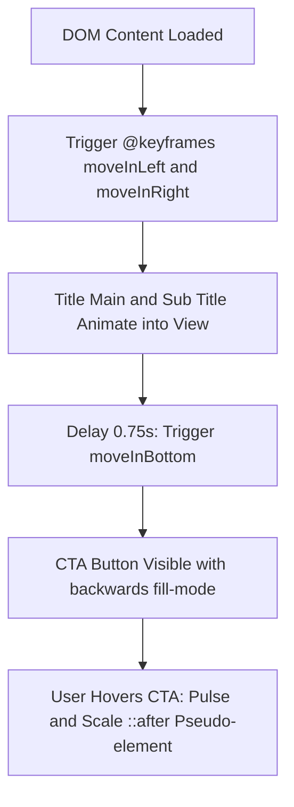

# F1: Slanted Hero Header & Keyframe CTA

## Overview & Architecture
The Hero section establishes the brand identity and dynamic feel of Wanderly using pure CSS techniques. It combines a polygonal angled cut at the bottom with staggered entry keyframe animations.

## Implementation Details
- **Source Files**: `01_Natours/sass/layout/_header.scss`, `01_Natours/sass/base/_animations.scss`, `01_Natours/sass/components/_button.scss`
- **Key Techniques**:
  - `clip-path: polygon(0 0, 100% 0, 100% 75vh, 0 100%)`
  - `@keyframes moveInLeft`, `@keyframes moveInRight`, `@keyframes moveInBottom`
  - Pseudo-element ripple animation on `.btn::after`

## Say It Out Loud
> "I built the hero section in `_header.scss` to deliver an immediate premium visual impact without any external animation libraries. I used CSS `clip-path: polygon()` to cut the bottom edge of the hero into a dynamic 75-vh angled slope. For the typography, I wrote custom CSS `@keyframes` in `_animations.scss` that animate both horizontal translation and opacity, timed with a cubic-bezier easing curve. The CTA button includes an animated pseudo-element ripple that expands and fades on hover. Because everything is handled by CSS transforms and opacity, the animation runs exclusively on the GPU compositor thread with zero layout reflows."
