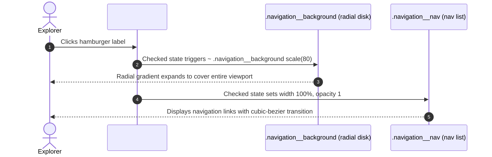

# F2: Pure CSS Fullscreen Navigation (Checkbox Hack)

## Overview & Architecture
A zero-JavaScript fullscreen modal navigation drawer activated entirely by the native HTML checkbox state machine.

## Say It Out Loud
> "To achieve an interactive fullscreen menu without JavaScript, I implemented the CSS checkbox hack in `_navigation.scss`. An invisible native checkbox is bound to an accessible circular button label. When the user clicks the hamburger icon, the checkbox toggles to `:checked`, which triggers the adjacent sibling combinator to scale an underlying green radial gradient circle from 6rem to eighty times its size. This instantly floods the viewport with color while the navigation links fade into view with cubic-bezier timing. If a user clicks outside or on a link, the checkbox state resets, collapsing the overlay smoothly back into the circular icon."
