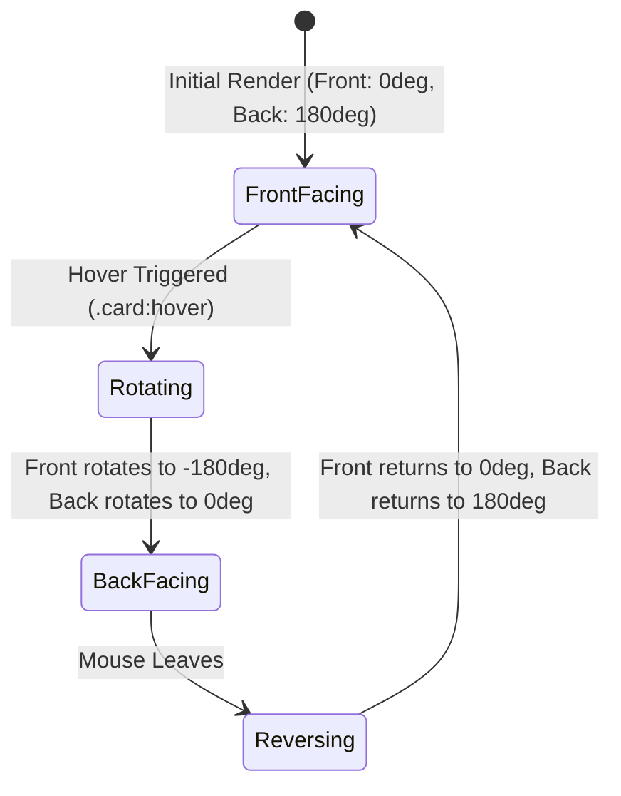

# F3: Interactive 3D Perspective Rotating Tour Cards

## Overview & Architecture
Three-dimensional card components displaying tour information on the front side and pricing/action triggers on the reverse side.

## Say It Out Loud
> "In `_card.scss`, I engineered the 3D rotating tour cards using native CSS 3D transforms. The parent container sets a `perspective: 150rem` to establish realistic visual depth. Inside, I created two mirrored card sides—front and back—positioned absolutely on top of each other with `backface-visibility: hidden`. When hovered, the front face rotates from 0 to negative 180 degrees, while the back face rotates from positive 180 degrees to 0. For mobile touchscreens where hover states don't exist, I added a media query for `hover: none` that automatically flattens the card into a single vertical card layout with the price immediately visible."
