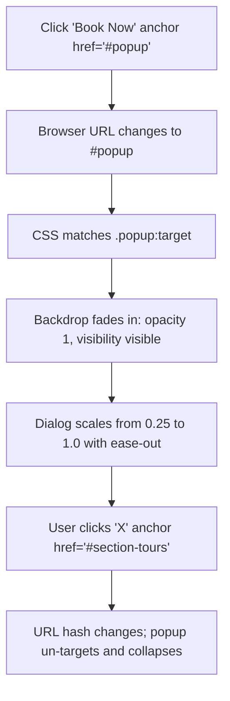

# F4: Pure CSS Modal Booking Popup (:target)

## Overview & Architecture
A modal dialog system activated through browser URL fragment identifiers via the `:target` CSS pseudo-class.

## Say It Out Loud
> "For the booking modal in `_popup.scss`, I eliminated the need for modal management JavaScript by utilizing the native CSS `:target` pseudo-class. When an explorer clicks 'Book now', the URL hash updates to `#popup`. The CSS selector `.popup:target` immediately activates, transitioning the backdrop from opacity zero to one and scaling the modal dialog box from 0.25 to full scale with a smooth bounce. Clicking the close button or anywhere outside the modal routes the anchor back to the tours section, immediately dismissing the target state and hiding the modal."
