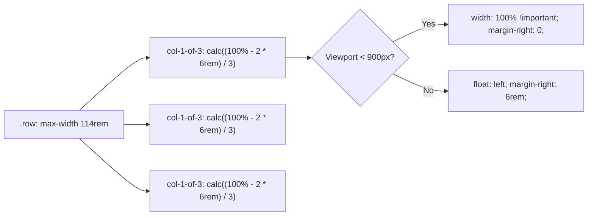

# F5: Custom Responsive Float Grid System

## Overview & Architecture
A mathematical grid engine based on SASS variables and `calc()` expressions with clearfix clearing.

## Say It Out Loud
> "I built the layout system in `_grid.scss` using a custom mathematical float grid powered by SASS variables and `calc()`. Instead of relying on a bloated framework, I defined row max-widths and column gutters programmatically. For example, a 1-of-3 column calculates its width dynamically as 100 percent minus twice the horizontal gutter divided by three. I paired this with a micro-clearfix mixin on every row to prevent float collapsing. Inside my responsive mixin, when the viewport drops below 900 pixels, the float is disabled and columns automatically collapse to full 100 percent width for clean vertical stacking."
